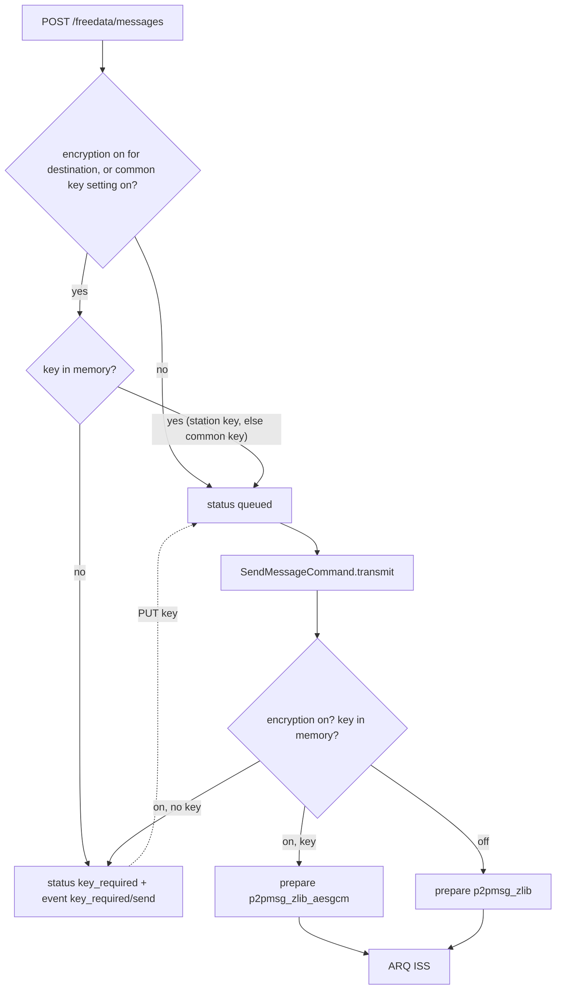

# Per-station message encryption

P2P chat messages can be encrypted with AES-256-GCM and a key the two operators
share in advance. Encryption is **off by default** and is switched on per station in the GUI,
or for all stations with a [common key](#common-key).

> **Legal note.** Most amateur radio regulations prohibit messages encoded to
> obscure their meaning: ITU Radio Regulations 25.2A, and national rules such as
> FCC §97.113(a)(4). Only use encryption on frequencies and under licences that
> allow it. The GUI shows this warning and asks for confirmation every time
> encryption is turned on for a station or the common key setting is switched on.

## What is and isn't encrypted

| Encrypted | Sent in the clear |
|---|---|
| The P2P message JSON: id, origin, destination, body and attachments | ARQ session frames (open, info, burst headers, ACKs) with the callsign checksums |
| | Beacons, CQ/QRV, PING, NORM broadcasts, P2P connections, raw ARQ data |
| | CW ID and other station identification |

An eavesdropper can still see who is talking to whom, when, and roughly how much
data was sent.

## Code

| File | Role |
|---|---|
| [encryption.py](../encryption.py) | `parse_key`, `encrypt`, `decrypt`, `decrypt_any`, `key_fingerprint`, `StationKeyStore`, `DecryptionError`, `KeyMissingError` |
| [arq_data_type_handler.py](../arq_data_type_handler.py) | ARQ type `p2pmsg_zlib_aesgcm = 21`: compress, then encrypt (and the reverse) |
| [message_p2p.py](../message_p2p.py) | `encryption_wanted`, `encrypted_message_received`, `decrypt_pending_messages`, `common_key_changed`, `decompress_p2pmsg` |
| [command_message_send.py](../command_message_send.py) | Picks the encrypted type when `encryption_wanted()`, holds messages without a key |
| [message_system_db_encryption.py](../message_system_db_encryption.py) | `DatabaseManagerEncryption`: pending received messages, messages waiting for a key |
| [message_system_db_station.py](../message_system_db_station.py) | `is_encryption_enabled`, `set_encryption_enabled` |
| [api/freedata.py](../api/freedata.py) | `/freedata/station/{callsign}/encryption` and `/freedata/encryption/common-key` endpoints |
| [api/config.py](../api/config.py) | Calls `common_key_changed()` when `POST /config` switches the common key setting on |

## Keys

- **Format.** The user enters either 64 hex characters (a raw 256-bit key, which the
  GUI's *Generate* button creates) or a passphrase of at least 12 characters.
  Passphrases are stretched with scrypt (`n=2^15, r=8, p=1`). Both stations must
  derive the same key, so the salt is a fixed FreeDATA constant, which makes
  passphrases weaker than random keys.
- **Storage.** Keys are kept in `ctx.station_keys` (`StationKeyStore`, thread safe), in
  memory only. They are never written to disk or sent over the air. After a server
  restart the GUI asks for them again when they are needed.
- **Lookup.** Keys are looked up by callsign including the SSID, the way message
  destinations are stored (`AA1AAA-0`). The receiving side uses the ARQ session's
  `dxcall`.
- **Fingerprint.** `key_fingerprint()` returns the first 64 bits of a SHA-256 hash
  as `XXXX XXXX XXXX XXXX`. The GUI shows it so both operators can check they
  entered the same key.

## Common key

One key shared by a group of stations, switched on in *Settings → Chat* (config
`[MESSAGES] enable_common_key`, default `False`).

- **On:** messages to **every** station are encrypted, whether or not encryption is on
  for the station (`encryption_wanted()`). A station's own key takes precedence:
  `StationKeyStore.key_for()` returns the station key if one is entered, otherwise the
  common key.
- **Receiving** tries the station key first, then the common key
  (`keys_for()` + `decrypt_any()`). The wire format has no key id, and a wrong key fails
  the GCM tag check, so trying both is safe.
- **Off:** the common key is not used, even if it is still in memory. Only stations
  with encryption switched on are encrypted, as before.
- **Storage:** like station keys, in memory only (`StationKeyStore.set_common()`). It
  has to be entered again after a server restart; until then, messages wait with
  status `key_required`.
- **Entering the key**, or switching the setting on while the key is in memory, runs
  `common_key_changed()`: it decrypts the pending received messages of all stations
  that the common key fits and queues all `key_required` messages again. Unlike a
  station key, a common key is never rejected because it doesn't fit pending messages
  (they may be from stations that use their own key).
- Stations that don't know the common key can't read your messages while the setting
  is on. Enter a station key for them, or switch the setting off.

## Explorer and PSK Reporter

Publishing station activity next to encrypted traffic is switched off. Encryption is
"in use" when the common key setting is on or encryption is on for at least one station
(`encryption_in_use()` in [message_p2p.py](../message_p2p.py)). Then:

- Turning encryption on (`PATCH .../encryption` with `enabled: true`, or `POST /config`
  with `MESSAGES.enable_common_key` on) calls `disable_reporting()` or does the same in
  `post_config`: `STATION.enable_explorer` and `STATION.enable_stats` are saved as `False`
  and PSK Reporter is switched off.
- While encryption is in use, `POST /config` saves those two settings as `False` whatever it
  is sent, and `POST /modem/pskreporter` with `enabled: true` is refused with 409.
- `AppContext.startup()` does the same check, for a config edited by hand.
- Turning all encryption off again does **not** switch reporting back on; the user does.
- The GUI (Settings → Web) greys out both switches and shows a note while
  `GET /modem/pskreporter` returns `blocked_by_encryption: true`.

## Wire format

ARQ type byte `21` (`p2pmsg_zlib_aesgcm`). The ARQ payload is:

```
version (1 byte, = 1) | nonce (12 random bytes) | AES-256-GCM ciphertext | tag (16 bytes)
```

The plaintext is the same raw-deflate stream as type `20` (`p2pmsg_zlib`). The
version byte is passed as associated data. The overhead is 29 bytes per message.
A station that doesn't know type 21 logs `Unknown handling endpoint` and drops
the data.

## Sending



- Whether to encrypt is decided when the message is **transmitted**, not when it is
  queued. A message queued before encryption was turned on is sent encrypted.
- `key_required` is a message status that `get_first_queued_message()` skips, so a
  message waiting for a key doesn't block the queue. `PUT .../encryption/key` puts
  these messages back to `queued`.
- If encryption is turned off while messages wait for a key, they stay on hold. The
  user can resend them with the retry button, and they are then sent unencrypted.
- After the transfer, the ISS decrypts its own payload with the same key to find the
  message id and calls `message_transmitted(..., encrypted=True)`. If the key was
  removed during the transfer, the status can't be updated. A message left in
  `transmitting` is set to `failed` at the next start.

## Receiving

`handle_p2pmsg_zlib_aesgcm` calls `encrypted_message_received(ctx, dxcall, data, stats)`:

1. The station key, or else the common key (if that setting is on), fits: decrypt,
   inflate, `message_received(..., encrypted=True)`.
2. No key, or no key that decrypts: the encrypted payload goes into the
   `pending_encrypted_message` table and the event
   `{"type": "encryption", "status": "key_required", "callsign": ..., "reason": "receive" | "wrong_key"}`
   is sent. The GUI then opens the key dialog.

`PUT .../encryption/key` runs `decrypt_pending_messages()`. Every pending message the
key decrypts is stored as a received message, keeping its original statistics and
frequency, and removed from the pending table. If messages are pending and the key
decrypts **none** of them, the key is rejected (400) and not stored. Decrypting
received messages doesn't require turning encryption on for the station.

## Database (schema version 2)

| Change | Purpose |
|---|---|
| `station.encryption_enabled` (Boolean, default false) | Per-station on/off switch |
| `p2p_message.encrypted` (Boolean, default false) | Message was sent or received encrypted (lock icon in the GUI) |
| table `pending_encrypted_message` (`id`, `callsign`, `data` BLOB, `statistics` JSON, `frequency`, `received_at`) | Received messages waiting for a key; the data is still encrypted |
| status `key_required` | Outgoing message waiting for a key |

Older databases are migrated by the normal additive schema update
(`MESSAGE_SYSTEM_DATABASE_VERSION` 1 → 2).

## API

| Method | Path | Body | Response | Errors |
|---|---|---|---|---|
| GET | `/freedata/station/{callsign}/encryption` | none | status object (below) | 400 invalid callsign |
| PATCH | `/freedata/station/{callsign}/encryption` | `{"enabled": true\|false}` | status object | 400 `'enabled' must be true or false`; 500 on a database error |
| PUT | `/freedata/station/{callsign}/encryption/key` | `{"key": "<64 hex chars or passphrase>"}` | status object plus `decrypted` and `requeued` counts | 400 invalid key, or key doesn't decrypt the waiting messages |
| DELETE | `/freedata/station/{callsign}/encryption/key` | none | status object | 400 invalid callsign |
| GET | `/freedata/encryption/common-key` | none | `{"enabled", "key_loaded", "fingerprint"}` | none |
| PUT | `/freedata/encryption/common-key` | `{"key": "<64 hex chars or passphrase>"}` | common key status plus `decrypted` and `requeued` counts | 400 invalid key |
| DELETE | `/freedata/encryption/common-key` | none | common key status | none |

The common key setting itself is `MESSAGES.enable_common_key` in `POST /config`.

Status object of a station:

```json
{"callsign": "AA1AAA-0", "enabled": true, "encrypted": true, "common_key_enabled": false,
 "key_loaded": true, "fingerprint": "E1FA C658 B808 9106", "key_source": "station",
 "pending_received": 0, "waiting_to_send": 0}
```

`enabled` is the station's own switch, `encrypted` whether messages to it are encrypted
(its switch or the common key setting). `key_loaded` and `fingerprint` refer to the
station key; `key_source` is `"station"`, `"common"` or `null` (no usable key).

The GUI side is described in
[freedata_gui/docs/chat-and-broadcasts.md](../../freedata_gui/docs/chat-and-broadcasts.md#encryption).

## Limitations

- No key exchange and no forward secrecy: anyone who later gets the key can decrypt
  recorded traffic.
- One key per station, used in both directions, plus at most one common key.
- Random 96-bit nonces are safe for far more messages than an HF link can carry.
- Message history in the local database is stored decrypted, as before.
- There is no replay protection beyond the duplicate message-id check in the database.
