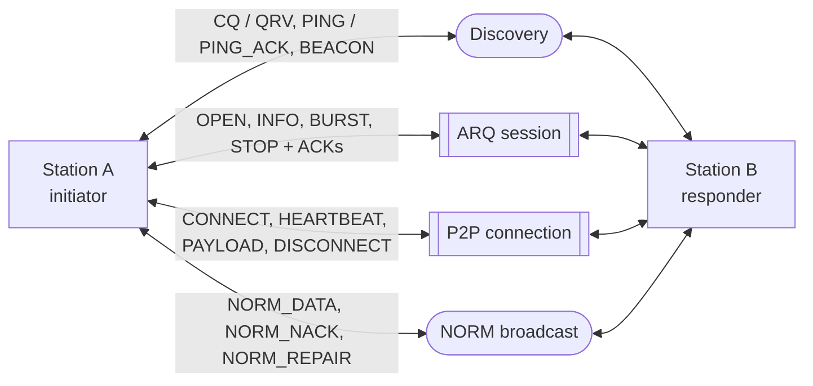
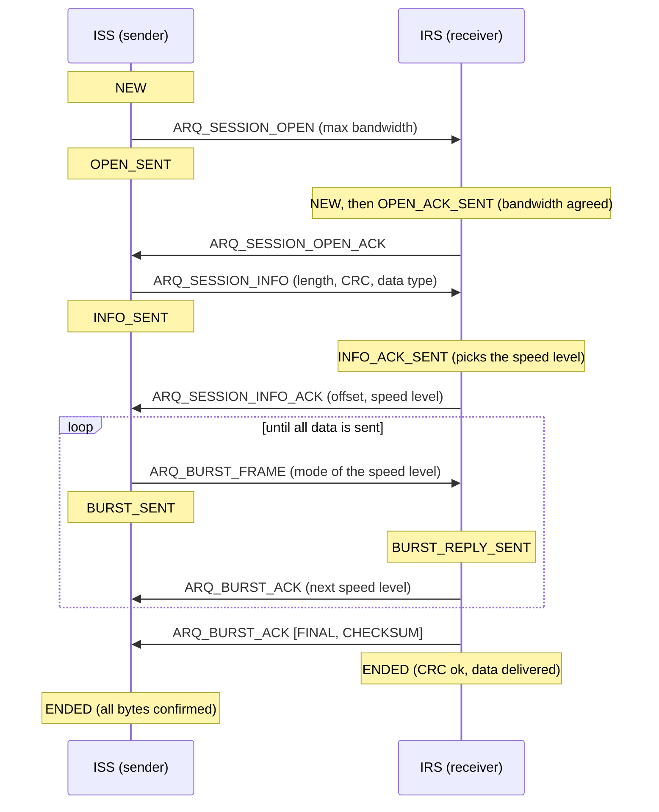
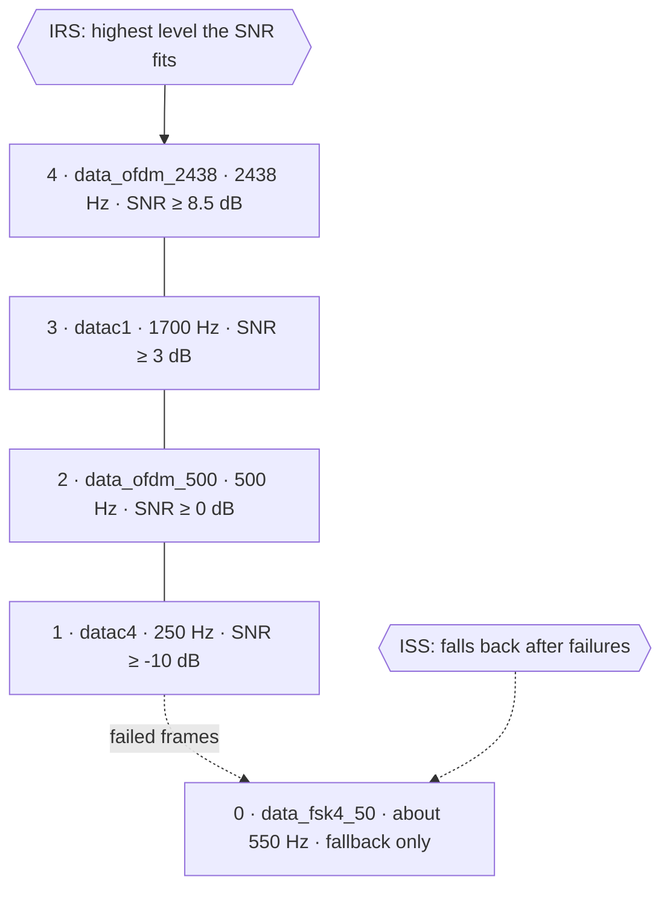
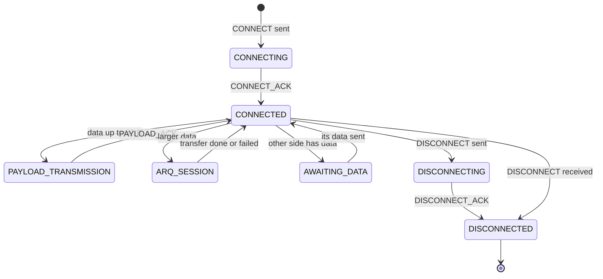
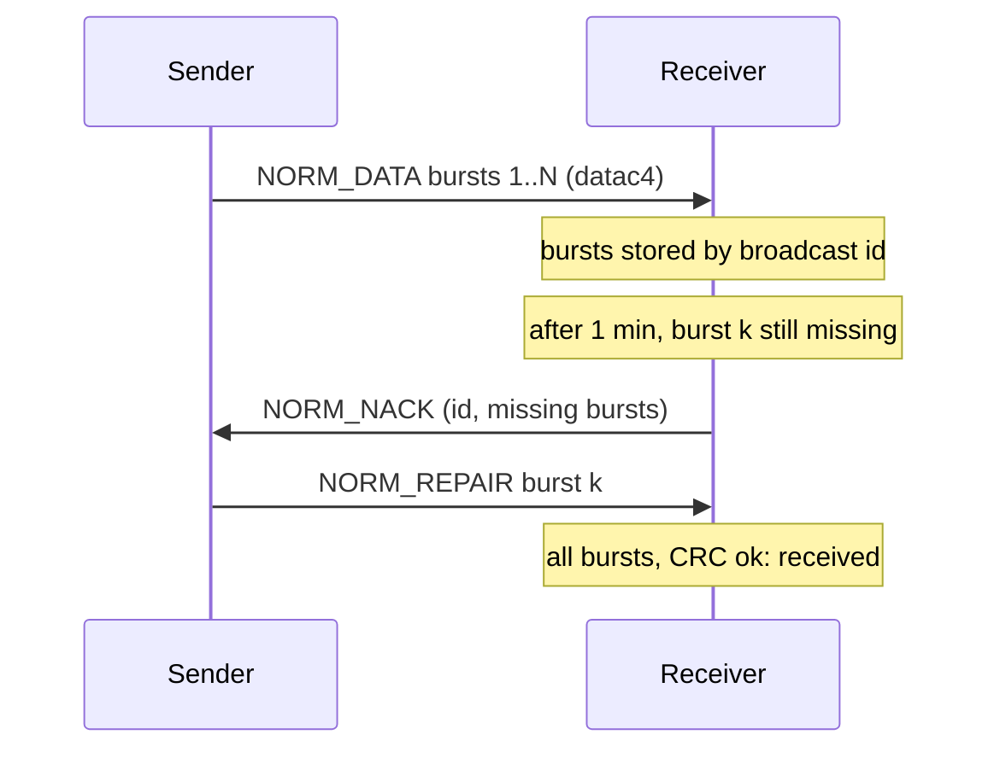

# Protocols between two stations

Two FreeDATA stations exchange four kinds of traffic. ARQ sessions and P2P connections keep a state
machine on each side; discovery frames and NORM broadcasts are single frames or bursts with no session.
This page is the overview: the frame layouts are in [protocol-frames.md](protocol-frames.md), and the
full state tables, timeouts and retry rules in [arq-sessions.md](arq-sessions.md).

| Traffic | Used for | State on both sides |
|---|---|---|
| Discovery | Calling, reachability checks, presence | No |
| ARQ session | Reliable transfer of messages and raw data | Yes ([arq-sessions.md](arq-sessions.md), sections 2 and 3) |
| P2P connection | Link for socket-interface clients (VARA-style) | Yes ([arq-sessions.md](arq-sessions.md), section 7) |
| NORM broadcast | Group chat to a domain, one to many | No; the receiver asks for missing bursts ([arq-sessions.md](arq-sessions.md), section 9) |

## Frames and modes

Each frame goes out in a fixed codec2 mode, except ARQ data bursts, whose mode follows the speed level.

| Traffic | Frames | Mode |
|---|---|---|
| Discovery | CQ, PING, BEACON | `signalling` (datac13); `data_vhf_1` when `EXP.enable_vhf` is on |
| Discovery replies | QRV, PING_ACK | `signalling` |
| ARQ control | ARQ_SESSION_OPEN, ARQ_SESSION_INFO, ARQ_STOP and their ACKs | `signalling`; `data_fsk4_50` once the session is on FSK |
| ARQ data | ARQ_BURST_FRAME | The mode of the current speed level (below) |
| ARQ burst ACK | ARQ_BURST_ACK, 3 bytes with no type byte | `signalling_ack` (datac14); `data_fsk4_50` on FSK |
| P2P control | P2P_CONNECTION_CONNECT, HEARTBEAT, DISCONNECT and their ACKs | `signalling` |
| P2P payload | P2P_CONNECTION_PAYLOAD | `signalling` up to 11 bytes, `datac4` up to 32 bytes; larger data runs as an ARQ session inside the connection |
| P2P payload ACK | P2P_CONNECTION_PAYLOAD_ACK | `signalling_ack` |
| NORM | NORM_DATA, NORM_NACK, NORM_REPAIR | `datac4`, 26 bytes of data per burst |

## ARQ session

The sender (ISS) and receiver (IRS) move through their states together: each frame the ISS sends moves the
IRS on, and the IRS's answer moves the ISS on.

From any state a session can also end early:

- **Stop:** the user stops the ISS, which goes to `ABORTING` and sends `ARQ_STOP`; the IRS answers
  `ARQ_STOP_ACK` and both end `ABORTED`. An IRS that aborts sets the abort flag in its next ACK.
- **Timeout:** a side whose retries run out, or whose wait for the other side expires, ends `FAILED`.
- **Lost final ACK:** an IRS in `ENDED` answers a repeated burst by resending its final ACK, without
  delivering the data again.

## Speed levels and FSK fallback

The IRS picks the speed level from the SNR of the frames it receives: the highest level whose minimum SNR
the signal meets, within the agreed bandwidth and the free channel slots. It reports the level in its ACKs
and the ISS builds the next burst in that mode. Level 0 is never chosen by SNR.

The fallback to FSK follows failures, not SNR: auroral and other strongly fading paths defeat every OFDM
mode even at a good SNR, while the 50-baud FSK mode still gets through. A session falls back when signalling
frames go unanswered twice, when two bursts fail at datac4, or when frames are heard but cannot be decoded
([arq-sessions.md](arq-sessions.md), section 4.1). It works only with `MODEM.enable_fsk` on at both
stations; a station without it cannot hear the other's FSK frames.

## P2P connection

A P2P connection is opened from the socket interface (`CONNECT` on the command port) and stays up until a
side disconnects. While connected, the stations take turns sending: the heartbeats every 5 s carry a
`HAS_DATA` flag, so a side with data waiting can take the turn.

The ARQ session inside a connection uses the connection's id and is addressed to the callsign the
connection was made to, which may be a `MYCALL` callsign of the socket interface. The responder enters
`CONNECTED` directly when it answers `CONNECT`.

## NORM broadcast

A broadcast goes out as `NORM_DATA` bursts, each with up to 26 bytes of the message. A receiver that misses a
burst asks for it again on its own: every 20 s its scheduler looks for broadcasts that are incomplete and
more than a minute old, and sends a `NORM_NACK` with the missing burst numbers. The original sender answers
with `NORM_REPAIR` bursts. The sender also sends the whole broadcast again on its own, first after an hour
and then at growing intervals, until it expires after a day or has had 20 attempts.

Broadcasts share the channel with ARQ sessions and with other stations' broadcasts, so every NORM
transmission (data, NACK or repair) first waits:

1. for a running ARQ session or P2P connection to end (up to 300 s; the scheduler does not start NORM
   traffic during one at all);
2. a random 0-5 s, or 0-15 s after a session, since both stations of the session release their
   held-back broadcasts at the same moment;
3. for a free channel, heard free for 0.5 s more: up to 5 s, or up to 90 s while another FreeDATA station
   is heard, which is long enough for its whole broadcast. After that it sends anyway.

On the air (2026-11-10) two stations sending broadcasts after the same ARQ session no longer overlap:
the second waits for the first one's last burst, and both arrive without repairs.

## Listen before talk

A transmission that starts something new first waits for a clear channel
([channel_gate.py](../channel_gate.py)), so a station does not key up over another station's FreeDATA
traffic. This covers ping, CQ, beacon, test frame, the reply to a CQ, the start of a P2P connection and
the start of every ARQ session: a raw ARQ transfer (`POST /modem/send_arq_raw`), a message (sent at once
or by the scheduler from the queue) and the ARQ session inside a P2P connection. Frames inside a running
session or connection are not delayed: the other station waits for them. Neither is the tune tone.

The channel counts as clear when, for `listen_time` seconds in a row, no FreeDATA signal is heard (and
none was in the last `freedata_holdoff` seconds, which covers the answer of a station this one cannot
hear) and the FFT check sees no other signal. A random delay follows, after which the channel must still
be clear: two stations that waited for the same session do not key up together. Then:

- FreeDATA traffic is never sent over. If it goes on for the maximum wait, the transmission is dropped:
  a ping or CQ is not sent, a message stays queued, a P2P connection puts its data back at the front of
  its queue and tries again on its next turn, and a retried session open ends the session as failed.
- A channel busy only from other signals (noise, a carrier, another mode) is waited for
  `other_busy_wait` seconds, counted from the last FreeDATA signal heard, and then sent on anyway.
- Stop ends the wait.

An ARQ session's first `ARQ_SESSION_OPEN` goes out at once after the gate. If it gets no answer, each
retry goes through the gate again, since there is no session on the channel yet. Until the other
station answers, a station counts what it hears as traffic; once the session runs, the other station's
frames are not counted as a busy channel.

The settings are in the `[CHANNEL]` section of `config.ini` (added with these defaults when the config
is loaded), times in seconds:

| Setting | Default | Meaning |
|---|---|---|
| `enable_listen_before_talk` | True | False sends everything at once |
| `listen_time` | 2 | the channel must stay clear this long |
| `freedata_holdoff` | 8 | after the last FreeDATA signal heard, the channel still counts as busy |
| `random_delay` | 3 | upper bound of the random delay |
| `freedata_max_wait` | 60 | FreeDATA traffic is waited for this long, then the transmission is dropped |
| `other_busy_wait` | 30 | other signals are waited for this long, then it is sent anyway |
| `beacon_max_wait` | 10 | `freedata_max_wait` for a beacon and for a queued message sent by the scheduler |
| `cq_reply_holdoff` | 1 | `freedata_holdoff` for a CQ reply and the ARQ session in a P2P connection: the other station was just heard |
| `cq_reply_max_wait` | 15 | `freedata_max_wait` for those two |
| `cq_reply_random_delay` | 5 | `random_delay` for a CQ reply, since several stations may answer |

The API calls that send (ping, CQ, beacon, test frame, message, raw ARQ) answer only after the wait,
which can take up to `freedata_max_wait` plus the listening time and random delay. The log shows each
wait as `[GATE]` lines.

On the air the gate passed on 2026-11-17 (pings, a CQ reply, a ping held through another session) and,
for messages, on 2026-11-20 (a ping held through a message session and sent 15 s after it, a P2P
transfer). On 2026-11-19 a message's session still keyed up over a ping, since messages were not yet
gated; that was fixed in merge 6d905497.

## Known issues

None of its own: this page summarizes the documents it links. See their known-issues sections for open
points in each protocol.
