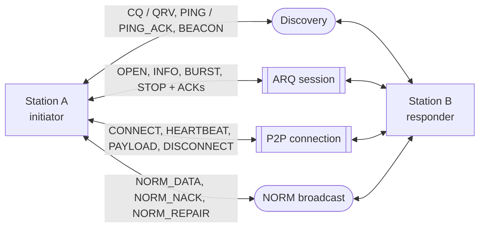
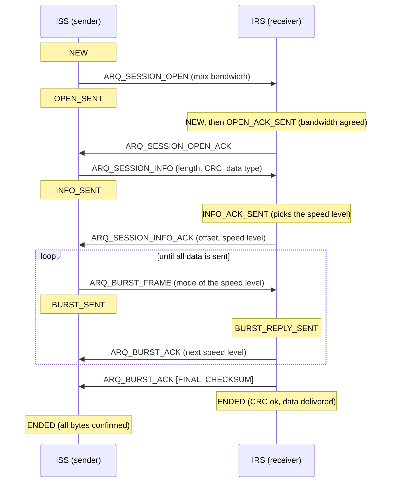
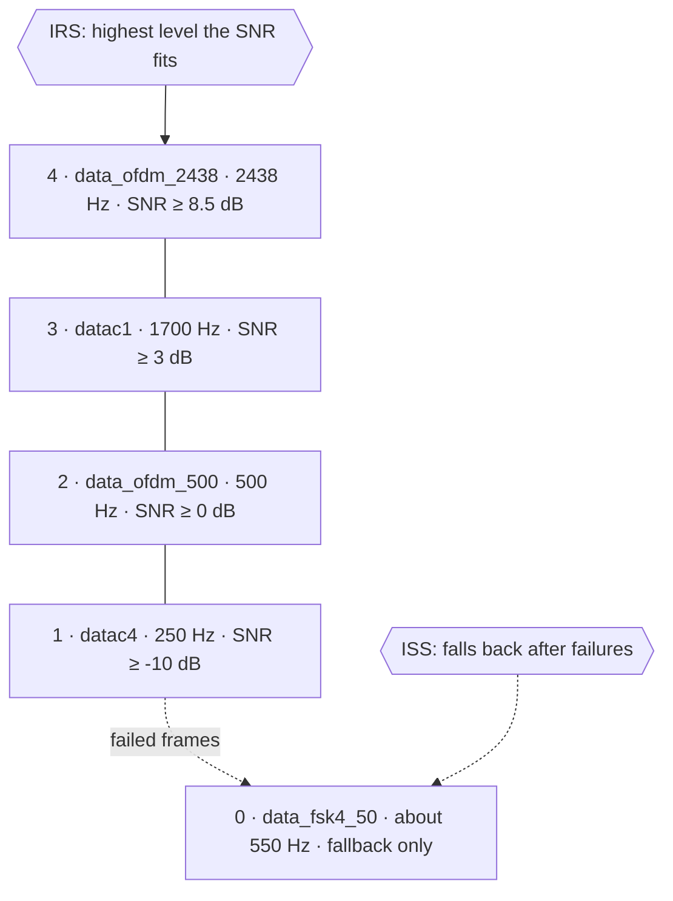
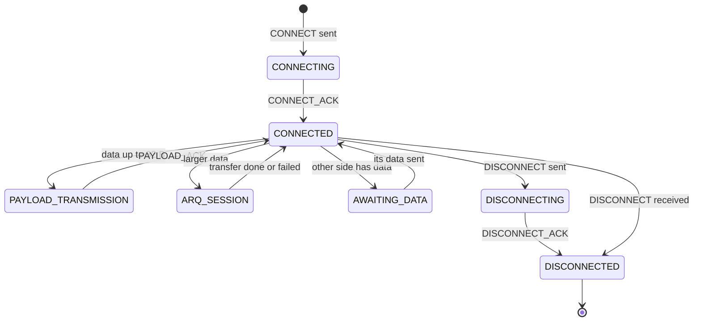
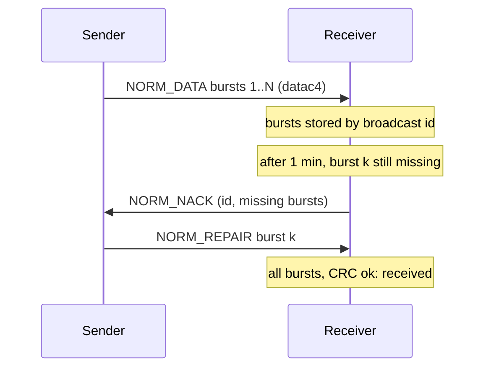

# Protocols between two stations

Two FreeDATA stations exchange four kinds of traffic. ARQ sessions and P2P connections keep a state
machine on each side; discovery frames and NORM broadcasts are single frames or bursts with no session.
This page is the overview: the frame layouts are in [protocol-frames.md](protocol-frames.md), and the
full state tables, timeouts and retry rules in [arq-sessions.md](arq-sessions.md).

| Traffic | Used for | State on both sides |
|---|---|---|
| Discovery | Calling, reachability checks, presence | No |
| ARQ session | Reliable transfer of messages and raw data | Yes ([arq-sessions.md](arq-sessions.md), sections 2 and 3) |
| P2P connection | Link for socket-interface clients (VARA-style) | Yes ([arq-sessions.md](arq-sessions.md), section 7) |
| NORM broadcast | Group chat to a domain, one to many | No; the receiver asks for missing bursts ([arq-sessions.md](arq-sessions.md), section 9) |

## Frames and modes

Each frame goes out in a fixed codec2 mode, except ARQ data bursts, whose mode follows the speed level.

| Traffic | Frames | Mode |
|---|---|---|
| Discovery | CQ, PING, BEACON | `signalling` (datac13); `data_vhf_1` when `EXP.enable_vhf` is on |
| Discovery replies | QRV, PING_ACK | `signalling` |
| ARQ control | ARQ_SESSION_OPEN, ARQ_SESSION_INFO, ARQ_STOP and their ACKs | `signalling`; `data_fsk4_50` once the session is on FSK |
| ARQ data | ARQ_BURST_FRAME | The mode of the current speed level (below) |
| ARQ burst ACK | ARQ_BURST_ACK, 3 bytes with no type byte | `signalling_ack` (datac14); `data_fsk4_50` on FSK |
| P2P control | P2P_CONNECTION_CONNECT, HEARTBEAT, DISCONNECT and their ACKs | `signalling` |
| P2P payload | P2P_CONNECTION_PAYLOAD | `signalling` up to 11 bytes, `datac4` up to 32 bytes; larger data runs as an ARQ session inside the connection |
| P2P payload ACK | P2P_CONNECTION_PAYLOAD_ACK | `signalling_ack` |
| NORM | NORM_DATA, NORM_NACK, NORM_REPAIR | `datac4`, 26 bytes of data per burst |

## ARQ session

The sender (ISS) and receiver (IRS) move through their states together: each frame the ISS sends moves the
IRS on, and the IRS's answer moves the ISS on.

From any state a session can also end early:

- **Stop:** the user stops the ISS, which goes to `ABORTING` and sends `ARQ_STOP`; the IRS answers
  `ARQ_STOP_ACK` and both end `ABORTED`. An IRS that aborts sets the abort flag in its next ACK.
- **Timeout:** a side whose retries run out, or whose wait for the other side expires, ends `FAILED`.
- **Lost final ACK:** an IRS in `ENDED` answers a repeated burst by resending its final ACK, without
  delivering the data again.

## Speed levels and FSK fallback

The IRS picks the speed level from the SNR of the frames it receives: the highest level whose minimum SNR
the signal meets, within the agreed bandwidth and the free channel slots. It reports the level in its ACKs
and the ISS builds the next burst in that mode. Level 0 is never chosen by SNR.

The fallback to FSK follows failures, not SNR: auroral and other strongly fading paths defeat every OFDM
mode even at a good SNR, while the 50-baud FSK mode still gets through. A session falls back when signalling
frames go unanswered twice, when two bursts fail at datac4, or when frames are heard but cannot be decoded
([arq-sessions.md](arq-sessions.md), section 4.1). It works only with `MODEM.enable_fsk` on at both
stations; a station without it cannot hear the other's FSK frames.

## P2P connection

A P2P connection is opened from the socket interface (`CONNECT` on the command port) and stays up until a
side disconnects. While connected, the stations take turns sending: the heartbeats every 5 s carry a
`HAS_DATA` flag, so a side with data waiting can take the turn.

The ARQ session inside a connection uses the connection's id and is addressed to the callsign the
connection was made to, which may be a `MYCALL` callsign of the socket interface. The responder enters
`CONNECTED` directly when it answers `CONNECT`.

## NORM broadcast

A broadcast goes out as `NORM_DATA` bursts, each with up to 26 bytes of the message. A receiver that misses a
burst asks for it again on its own: every 20 s its scheduler looks for broadcasts that are incomplete and
more than a minute old, and sends a `NORM_NACK` with the missing burst numbers. The original sender answers
with `NORM_REPAIR` bursts.

## Known issues

None of its own: this page summarizes the documents it links. See their known-issues sections for open
points in each protocol.
