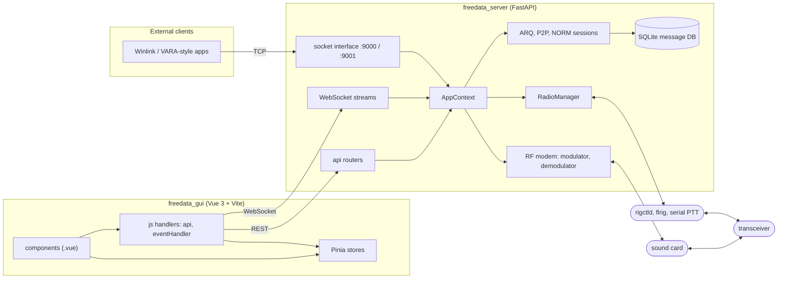
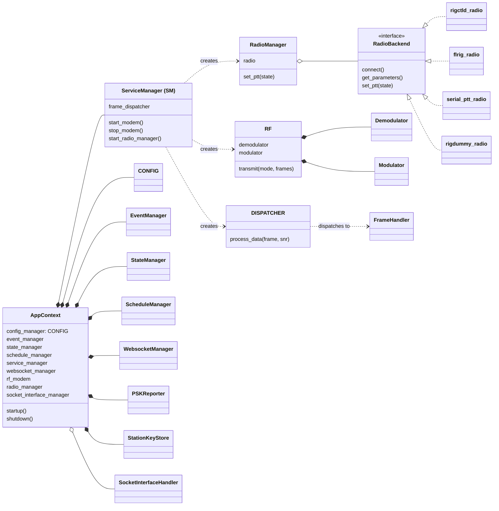
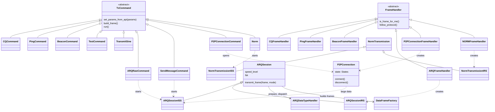
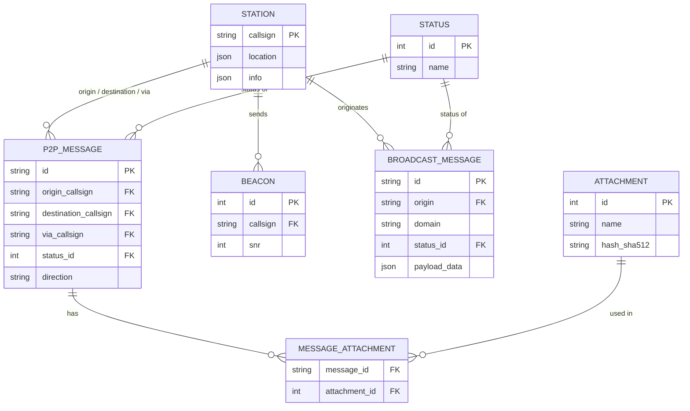

# UML views

Four views of FreeDATA as it is built: its components, the server's core classes, the protocol class
hierarchies and the message database. The class diagrams show structure, not every field or method; the
details are in [architecture.md](architecture.md), [protocol-frames.md](protocol-frames.md),
[arq-sessions.md](arq-sessions.md) and [message-system.md](message-system.md).

## Components

The GUI and other clients reach the server over REST, WebSocket and the TCP socket interface. The server
drives the sound card and the radio's control interface, and stores messages in SQLite.

The GUI's Vue components, Pinia stores and JS handlers are modules, not classes, so they appear here only
as components.

## Server core

One `AppContext` ([context.py](../context.py)) holds the config and the managers. The service manager
(class `SM` in [service_manager.py](../service_manager.py)) creates the RF modem, the frame dispatcher and
the radio manager when the modem starts, and drops them when it stops.

The four radio backends are each a class named `radio` in their own module (`rigctld.py`, `flrig.py`,
`serial_ptt.py`, `rigdummy.py`). They share no base class: `RadioBackend` stands for the methods
`RadioManager` calls on them.

## Protocol classes

Transmissions start as `TxCommand` subclasses, called from the API, the scheduler or the socket interface.
Received frames go through the dispatcher to a `FrameHandler` subclass by frame type. Both feed the classes
that keep protocol state: ARQ sessions, P2P connections and NORM transmissions.

[protocol-overview.md](protocol-overview.md) shows how these classes talk to their counterparts on the
other station.

## Message database

The SQLAlchemy models live in [message_system_db_model.py](../message_system_db_model.py). Each
`DatabaseManager*` class (messages, attachments, beacons, stations, broadcasts, encryption) wraps one area
of this schema; the configuration and pending encrypted messages have tables of their own, not shown.

## Known issues

None of its own: this page summarizes the code and the documents it links.
