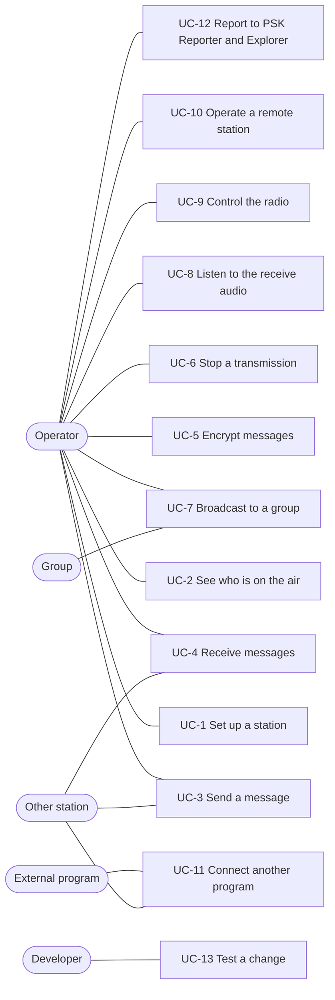

# Use cases

What people and programs do with FreeDATA, step by step, and what happens underneath. Each use case names
the screens and API calls involved and links to the documents that describe them in detail. The GUI is
described in [freedata_gui/docs](../../freedata_gui/docs/README.md); everything the GUI does is also
available through the [API](api.md).

## Actors

| Actor | Who or what |
|---|---|
| Operator | A radio amateur using the web GUI at `http://127.0.0.1:5000/gui`, on the station computer or remotely |
| Other station | Another FreeDATA station on the air (0.30 or newer, radio protocol version 2) |
| Group | The stations listening to a broadcast domain |
| External program | A program using the REST/WebSocket API or the VARA-style TCP interface |
| Developer | Someone changing FreeDATA and running its tests and simulators |

## UC-1 Set up a station

**Goal:** a station that can send and receive. **Before:** FreeDATA installed (README), the radio
connected for audio and CAT.

1. Open the GUI. The startup check lists what is missing (audio devices, radio control, callsign).
2. In **Settings**, enter the callsign, SSID and grid locator (`STATION.mycall`, `myssid`, `mygrid`).
3. Choose the audio input and output devices (`AUDIO`). A device the system renumbers after a restart (a
   USB sound card under another ALSA card number) is found again by its name.
4. Choose the radio control: Hamlib rigctld (`RADIO.control = rigctld` or the bundled `rigctld_bundle`),
   flrig, serial PTT, or none. For rigctld set the radio model, serial port and speed, and the PTT type;
   `RIG` (CAT) works for most radios with a USB audio interface. Types Hamlib does not know (`USB`,
   `MICDATA`) are changed to `RIG`.
5. Optional modem settings (`MODEM`): the maximum bandwidth, higher code rates (on by default) and the HF
   FSK modes for poor channels (off by default; both stations need them on).
6. Save. The server restarts the modem when a setting that needs it changes.

**Result:** the footer shows the modem running and the radio connected; the waterfall shows the band.

**See also:** [architecture.md](architecture.md) (configuration keys),
[modem-audio-radio.md](modem-audio-radio.md) (audio devices, radio control backends),
[screens-and-settings.md](../../freedata_gui/docs/screens-and-settings.md).

## UC-2 See who is on the air

**Goal:** know which stations can be reached and how well.

1. Watch the waterfall and the **Heard stations** list (a home-grid widget, and a screen of its own that
   sorts by callsign or time, in local time, with the frequency each station was heard on). Stations
   running a version before 0.30 have a red background: they cannot exchange data with this one.
2. Call **CQ** (`POST /modem/cqcqcq`); stations that hear it answer with `QRV`.
3. **Ping** a station (`POST /modem/ping_ping`); its `PING_ACK` reports the SNR it heard the ping with.
4. Turn the **beacon** on (`POST /modem/beacon`) so others hear this station regularly, optionally with
   "away from key".
5. Send a **test frame** (`POST /modem/send_test_frame`, in the tune dialog); the other station shows it
   with its SNR, which helps set the audio levels.

**See also:** [protocol-overview.md](protocol-overview.md) (discovery), [protocol-frames.md](protocol-frames.md).

## UC-3 Send a message

**Goal:** a text message, optionally with attachments, delivered to another station.
**Before:** UC-1; the other station is on the same frequency.

1. In **Chat**, start a conversation with the station's callsign (or open an existing one), write the text
   and attach files if needed, then send (`POST /freedata/messages`).
2. The message is stored as `queued`. The **Message queue** screen lists waiting messages; a queued message
   can be moved to the end (**Send last**) or deleted.
3. The scheduler sends the first queued message when no ARQ session is running: it opens an ARQ session,
   tells the receiver the size and CRC, and sends the compressed message in bursts.
4. The receiving station chooses the speed level from the SNR after each burst. On a good path both
   stations use the higher code rates (speed levels 5-7) if both have them on; on a poor one they drop to
   lower levels and, if both have the FSK modes on, to `data_fsk4_50`.
5. When the receiver has all data and the CRC matches, it acknowledges with the checksum flag; the message
   becomes `transmitted`.

**Alternatives:**

- The session fails (no answer, too many lost bursts): the message becomes `failed`. With
  `MESSAGES.enable_auto_repeat` on, it is queued again the next time the station is heard (beacon, CQ or
  ping, SNR at least -2 dB), up to 10 times. A manual **retransmit** queues it at once.
- The session is interrupted and the same message is sent again under the same session id: the receiver
  continues where it stopped, but only if the length and CRC match (other data starts over).
- **Message log:** `GET /freedata/messages/log` downloads the completed messages as CSV.

**See also:** [message-system.md](message-system.md), [arq-sessions.md](arq-sessions.md),
[chat-and-broadcasts.md](../../freedata_gui/docs/chat-and-broadcasts.md).

## UC-4 Receive messages

**Goal:** read what other stations send.

1. Nothing to start: the modem decodes the session, checks the CRC, decompresses the message and stores it
   as `received`.
2. **Chat** shows an unread badge; opening the conversation marks it read. Attachments are downloaded from
   the message.
3. A message received again with the same id is not stored twice.

**See also:** [message-system.md](message-system.md), section 3.

## UC-5 Encrypt messages

**Goal:** message contents that only the intended station can read. Check first that your licence allows
encryption on the bands you use ([encryption.md](encryption.md) has the legal note).

1. Agree on a key with the other station outside the radio link.
2. Enter it for that station (`PUT /freedata/station/{callsign}/encryption/key`) and turn encryption on
   for it, or set a common key for all stations (`/freedata/encryption/common-key`).
3. Messages to that station are encrypted with AES-256-GCM. A received encrypted message waits until its key
   is entered, then is decrypted.
4. While any encryption is on, Explorer and PSK Reporter reporting are switched off and stay locked off.

**See also:** [encryption.md](encryption.md).

## UC-6 Stop a transmission

**Goal:** stop sending now, for example when the frequency becomes busy.

1. Press **Stop** (the Stop widget, `POST /modem/stop_transmission`).
2. Every transmission stops: an ARQ sending station sends `ARQ_STOP`, NORM bursts stop before the next
   one, queued and transmitting messages and broadcasts become `aborted` so that neither the scheduler nor
   auto-repeat sends them again.
3. Pressed on the **receiving** station, the stop ends its session as `ABORTED`, and it answers the sender's
   next frames with the abort flag, so the sender stops too instead of retrying.

**See also:** [message-system.md](message-system.md) (Stop button), [arq-sessions.md](arq-sessions.md).

## UC-7 Broadcast to a group (experimental)

**Goal:** a short message to every station listening to a domain (a group name), without addressing each.
**Before:** group chat on (`EXP.enable_groupchat`) on the sending and receiving stations.

1. Open **Broadcasts**, choose or name a domain, write up to 390 bytes (15 bursts of 26 bytes) and send
   (`POST /freedata/broadcasts`). The GUI also has a form that builds a METAR weather report.
2. The broadcast waits for a clear channel: for a running ARQ session or P2P connection to end, a random
   delay, and for another station's broadcast to finish. Then it goes out as `NORM_DATA` bursts.
3. Each receiving station stores the bursts. When all have arrived and the CRC matches, the broadcast shows
   under its domain as unread.
4. A station that missed bursts asks for them with `NORM_NACK` a minute or more later; the sender answers
   with `NORM_REPAIR` bursts.
5. The sender also repeats the whole broadcast on its own, first after an hour and then at growing
   intervals, until it expires after a day. Deleting the broadcast stops the repeats.

**Tested on the air** (2026-11-10, 1 W, 40 m): broadcasts both ways, repair of one and two lost bursts, and
two stations sending broadcasts right after the same ARQ session without overlapping.

**See also:** [protocol-overview.md](protocol-overview.md) (NORM broadcast), [arq-sessions.md](arq-sessions.md)
(section 9), [message-system.md](message-system.md) (section 7).

## UC-8 Listen to the receive audio

**Goal:** hear the band through the browser, for example on a remote station.

1. Add the **Audio Stream** widget to the home grid (Audio category) and press **Listen**.
2. The browser receives the receive audio as 8 kHz, 16-bit mono (128 kbit/s, about 0.3-0.6 s delay).
   Mute and the volume (0-400 %) stay in the browser.
3. While the station transmits, the server sends no audio and the widget shows TX.
4. **Stop** closes the stream; with nobody listening, nothing is sent.

**See also:** [api.md](api.md) (`/audio_rx`), [dashboard-grid.md](../../freedata_gui/docs/dashboard-grid.md).

## UC-9 Control the radio

**Goal:** change the radio's settings from the GUI.

1. Set the frequency and mode (Frequency widget or the frequency list; `POST /radio/`), the RF power level
   and the antenna tuner.
2. **Tune:** the tune dialog sends a steady tone for an external tuner or for setting levels
   (`POST /radio/tune`).
3. **Clock:** `POST /radio/clock` sets the radio's clock from the computer's (rigctld, radios with a clock).
   A Clock widget shows local time and UTC.

**See also:** [modem-audio-radio.md](modem-audio-radio.md) (radio control), [api.md](api.md).

## UC-10 Operate a remote station

**Goal:** run the station from elsewhere, for example a Raspberry Pi next to the radio.

1. Run the server on the station computer (the Linux install script builds codec2 and Hamlib there).
2. The server listens on `127.0.0.1` only (`NETWORK.modemaddress`) and has no login. Reach it through an
   SSH tunnel (`ssh -L 5000:127.0.0.1:5000 station`, then open `http://127.0.0.1:5000/gui`) or a VPN rather
   than opening it to the network ([SECURITY.md](../../SECURITY.md)).
3. Use the GUI as on the station itself, including UC-8 to hear the band.

## UC-11 Connect another program

**Goal:** let another program (a mail or chat client) use the HF link.

- **TCP interface** (`SOCKET_INTERFACE`, ports 9000 for commands and 9001 for data): a VARA-style interface.
  The program connects to another station, which opens a P2P connection, and sends and receives data over
  it.
- **REST and WebSocket API:** everything the GUI does, with events on `/events`, state on `/states`, the
  spectrum on `/fft` and receive audio on `/audio_rx`. `POST /modem/send_arq_raw` sends raw data in an ARQ
  session.

**See also:** [arq-sessions.md](arq-sessions.md) (P2P connections, TCP socket interface), [api.md](api.md).

## UC-12 Report to PSK Reporter and Explorer

**Goal:** share which stations this station hears.

1. Turn on PSK Reporter (`POST /modem/pskreporter`, also a settings switch) and/or Explorer
   (`STATION.enable_explorer`).
2. Heard stations are reported with frequency and SNR; PSK Reporter uploads at most every five minutes.
3. Both stay off while any encryption is on (UC-5).

**See also:** [pskreporter.md](pskreporter.md).

## UC-13 Test a change

**Goal:** know that a change works before it goes on the air.

1. Run the test suite (`tools/run-tests.sh`, or `pytest tests`); many tests run two stations in one process
   with a simulated channel.
2. Try a mode on a fading channel with `tools/channel_sim.py`, or a whole ARQ session in real time with
   `tools/arq_session_sim.py`.
3. Then test on the air between two stations at low power.

**See also:** [testing.md](testing.md), [fading-channels.md](fading-channels.md).

## Known issues

- UC-7 is experimental and off by default; its timing (random delays, the one-hour first repeat) has been
  tried with two stations only.
- UC-10: the API has no login. Anyone who can reach it can control the station and listen to it.
